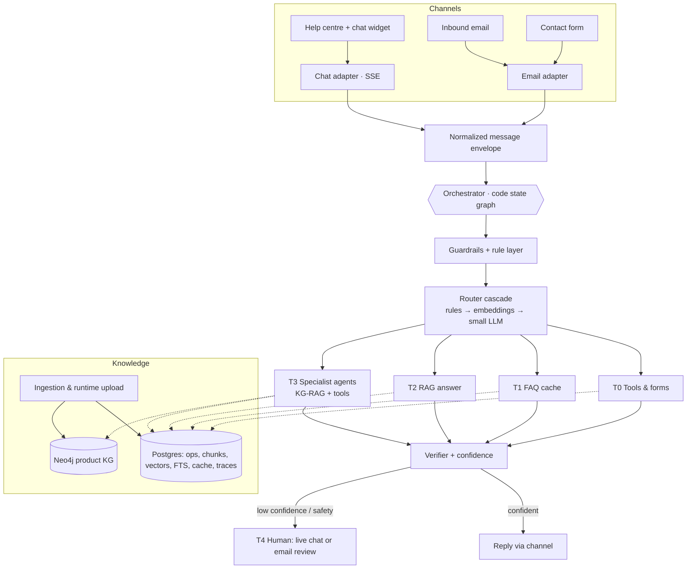
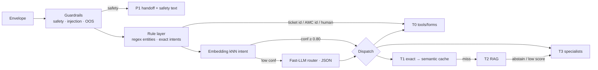
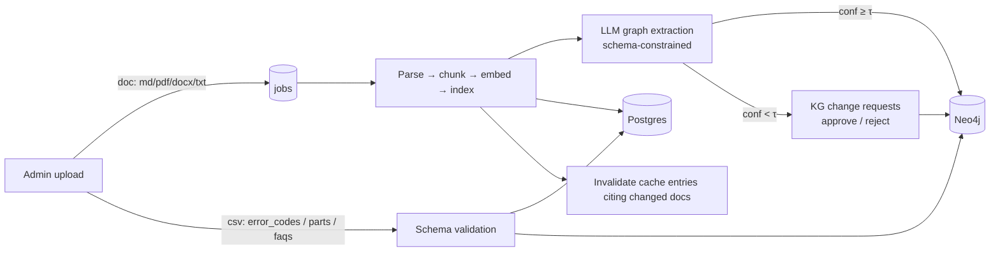
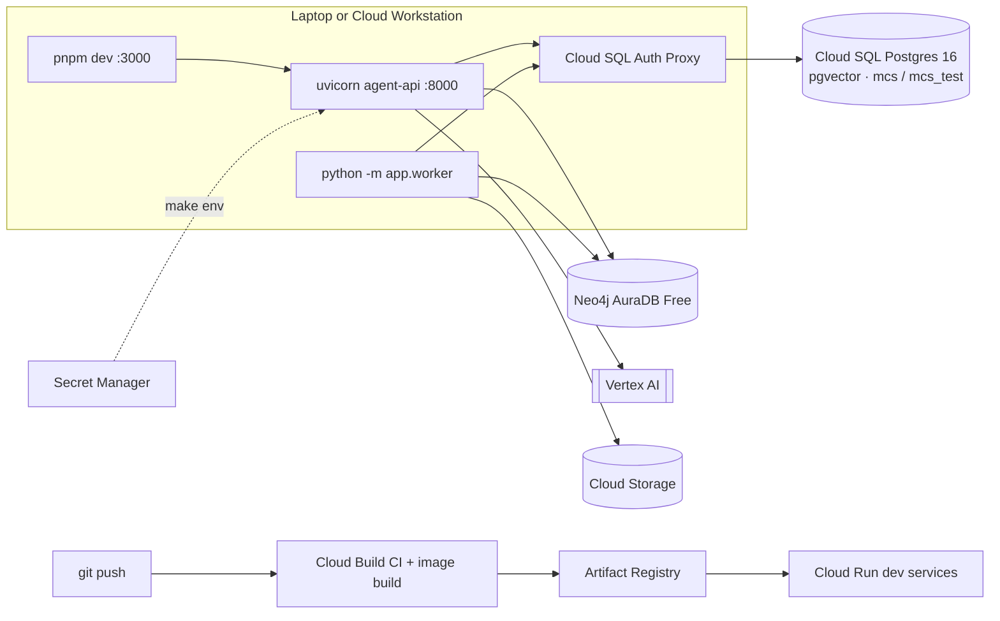
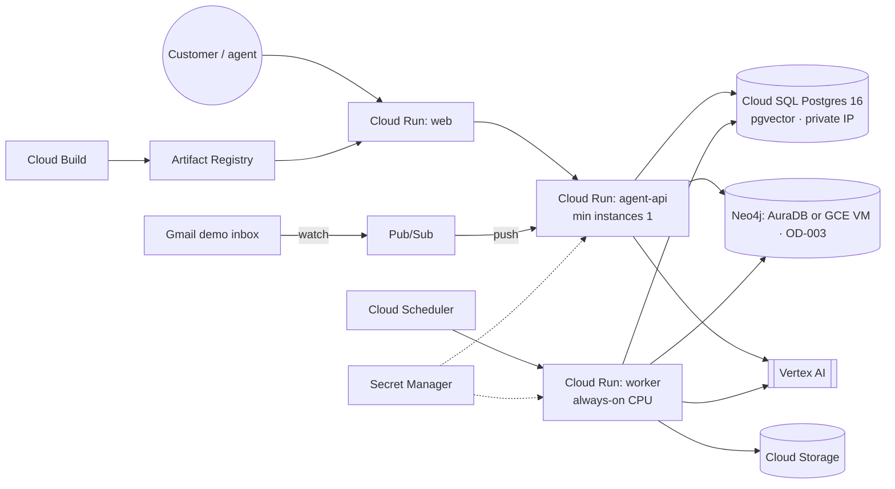

## 1. Context and goals {#HLD-1}

Matsui's customers contact support for FAQs, troubleshooting, ticket/AMC status, spare parts and quotes. This POC shows a **low-latency hybrid multi-agent service desk** for **email and chat** that:

1. answers routine requests from rules and caches in milliseconds (no large model on the hot path),
2. reasons over product knowledge with **KG-RAG** for multi-hop troubleshooting,
3. checks answers for grounding before they leave the system, and
4. hands off to humans with full context when confidence is low or safety is involved.

**Success metrics** (from the registry): T0/T1 p95 under 300 ms and at least 50% fast-path share ([NFR-PERF-01](Requirements.html#NFR-PERF-01), [NFR-PERF-03](Requirements.html#NFR-PERF-03)); groundedness at least 0.90 and zero fabricated answers on unknowns ([NFR-QUAL-01](Requirements.html#NFR-QUAL-01)); routing accuracy at least 90% ([NFR-QUAL-02](Requirements.html#NFR-QUAL-02)); measurable multi-hop gain of hybrid KG-RAG over vector RAG ([NFR-QUAL-03](Requirements.html#NFR-QUAL-03)).

## 2. Scope and constraints {#HLD-2}

| | In this POC | Later |
|---|---|---|
| Channels | Chat widget (SSE), email (built-in demo mailbox + Gmail API adapter), contact form | Voice (STT/TTS on the chat fast path), WhatsApp |
| Knowledge | Synthetic manuals, policies, FAQs, catalog, KG; runtime uploads | Real Matsui manuals, ERP/CRM connectors |
| Users | Customers (demo personas), agents, admins | SSO with Matsui IdP |
| Attachments | Stored and shown to humans | AI parsing (photos of nameplates, PDFs) |

**Constraints:** Google Cloud for every environment, **no local Docker** (D-015); one developer with Claude Code; all data synthetic and labelled as demo ([DR-03](Requirements.html#DR-03)); the core must be channel-agnostic so voice can reuse it ([BR-05](Requirements.html#BR-05)).

## 3. Functional architecture {#HLD-3}

### 3.1 Channels and adapters {#HLD-3.1}

Each channel has an adapter that converts native input into one **message envelope** (channel, conversation id, customer identity, text, attachments, metadata) and renders the orchestrator's output back into the channel format ([FR-OR-01](Requirements.html#FR-OR-01)).

- **Chat:** the widget opens a session and streams the reply over SSE (status, tokens, citations, quick actions, forms, handoff events) ([FR-CH-01](Requirements.html#FR-CH-01)).
- **Email:** an `InboundMailAdapter` has two implementations: a built-in **demo mailbox** (Postgres inbox/outbox shown in the console) for dev, tests and offline demos, and a **Gmail API** adapter for a real demo inbox (Pub/Sub push notifications to Cloud Run; replies sent through the Gmail API) (D-016). It threads by Message-ID/References and by the ticket reference in the subject ([FR-EM-01](Requirements.html#FR-EM-01)). The help-centre contact form enters the same pipeline ([FR-UI-03](Requirements.html#FR-UI-03)).
- **Voice (later):** an STT → envelope → orchestrator (chat policy) → TTS adapter; no core changes.

### 3.2 Orchestrator {#HLD-3.2}

A **code-defined state graph** (LangGraph `StateGraph`) owns the flow. Edges are deterministic Python functions; LLMs only run inside specific nodes ([FR-OR-02](Requirements.html#FR-OR-02), D-001). The orchestrator:

- keeps conversation state: active specialist, extracted entities (model, serial, error code, city), open slots, last evidence ([FR-CH-02](Requirements.html#FR-CH-02)),
- applies the **channel policy profile** (latency budget, verification mode, auto-send threshold, allowed tiers) ([FR-OR-04](Requirements.html#FR-OR-04)),
- decomposes multi-question emails into sub-queries answered in parallel and merges them ([FR-EM-02](Requirements.html#FR-EM-02)),
- enforces per-node timeouts and falls back gracefully ([FR-OR-06](Requirements.html#FR-OR-06)).

An **LLM supervisor is used only where it pays off**: the T3 planner for messy multi-intent requests and the email path, where latency is not user-facing.

### 3.3 Tiered cascade and router {#HLD-3.3}

| Tier | Handles | Mechanism | LLM calls | Target p95 |
|---|---|---|---|---|
| T0 | Greetings, ticket/AMC/warranty lookup, create ticket, talk to human, safety | Regex + dictionaries + typed tools + slot-filling FSM | 0 | under 300 ms |
| T1 | Public FAQs and paraphrases | Exact normalized-text cache, then semantic FAQ cache (cos ≥ 0.90) | 0 (1 embedding) | under 300 ms |
| T2 | Single-hop knowledge questions | Hybrid retrieval + rerank + one fast-model call with citations | 1 | first token under 1.2 s |
| T3 | Multi-hop troubleshooting, parts + stock + coverage, multi-intent | Specialist agents with KG-RAG + tools | 1–3 | first token under 2.5 s |
| T4 | Low confidence, safety, angry escalation, explicit request | Human queue (chat) / review queue (email) | 1 (summary) | — |

The router itself is a cascade ([FR-RT-01](Requirements.html#FR-RT-01) → [FR-RT-02](Requirements.html#FR-RT-02) → [FR-RT-03](Requirements.html#FR-RT-03)): most traffic is resolved by rules and the embedding classifier; only ambiguous messages pay for the small-LLM router. **Retrieval starts in parallel with routing** (speculative) so context is ready when T2/T3 begin.

### 3.4 Specialist agents and tools {#HLD-3.4}

| Agent | Responsibility | Main tools / data | Pattern |
|---|---|---|---|
| Troubleshooting | Diagnose error codes and symptoms; customer-safe steps first; offer service request | KG templates (diagnose, shared causes), manual chunks | Handoff-capable specialist ([FR-AG-01](Requirements.html#FR-AG-01)) |
| Service request | Create ticket: serial, issue, contact; rule-based priority | `create_ticket`, asset lookup, inline form | Deterministic FSM, LLM only for slot extraction ([FR-AG-02](Requirements.html#FR-AG-02)) |
| Account lookups | Ticket, asset, warranty, AMC status | Postgres tools, customer-scoped | T0 tools ([FR-AG-03](Requirements.html#FR-AG-03)) |
| Parts | Compatible part, price, stock per warehouse, lead time, quote request | KG `STOCKED_AT`, `FITS`, `create_parts_quote` | Specialist ([FR-AG-04](Requirements.html#FR-AG-04)) |
| Sales lead | Capture quote requests and route to sales | `create_lead` | Specialist ([FR-AG-05](Requirements.html#FR-AG-05)) |

In chat, the active specialist stays **sticky** across turns (handoff/swarm pattern), so follow-ups skip routing unless the rule layer detects an intent switch ([FR-OR-05](Requirements.html#FR-OR-05)). Tools enforce that records belong to the identified customer ([FR-AG-06](Requirements.html#FR-AG-06)).

### 3.5 Knowledge layer: RAG, KG and hybrid {#HLD-3.5}

**Two complementary stores:**

- **Document index (Postgres + pgvector + FTS):** policies, manuals, bulletins, chunked by heading with tables and error-code sections kept whole ([FR-RG-02](Requirements.html#FR-RG-02)). Hybrid lexical + vector retrieval with RRF, metadata filters and reranking ([FR-RG-01](Requirements.html#FR-RG-01), [FR-RG-03](Requirements.html#FR-RG-03), [FR-RG-04](Requirements.html#FR-RG-04)). Superseded versions are excluded ([FR-RG-06](Requirements.html#FR-RG-06)).
- **Product knowledge graph (Neo4j):** `Model → ErrorCode → Cause → Resolution → SparePart → Warehouse`, plus components, service centres, AMC coverage and documents ([FR-KG-01](Requirements.html#FR-KG-01)).

**Why both:** questions like *"Our DHD-150 shows E04 — which part do we need and is it in stock in Pune, and is it covered by Platinum AMC?"* need 4–5 hops across entities. Vector RAG tends to retrieve the right manual section but cannot reliably join stock and coverage; the KG answers the joins exactly and points back to the manual chunk for the explanation ([FR-KG-05](Requirements.html#FR-KG-05)).

**GraphRAG strategy (D-006):** link entities → run **parameterized Cypher templates** for known patterns (fast, safe) → fall back to **guarded Text2Cypher** for the long tail ([FR-KG-02](Requirements.html#FR-KG-02), [FR-KG-03](Requirements.html#FR-KG-03), [FR-KG-04](Requirements.html#FR-KG-04)). Customer data stays in Postgres and is accessed through tools, not the graph.

**Benchmark:** the eval harness runs RAG-only, KG-only and hybrid on the labelled set (183 items, 1–5 hops) to give a reproducible comparison ([FR-KG-06](Requirements.html#FR-KG-06), [DR-02](Requirements.html#DR-02)).

### 3.6 Verification and hallucination control {#HLD-3.6}

| Layer | Check | Chat | Email |
|---|---|---|---|
| Prompting | Cite evidence ids for every claim; abstain when unsupported ([FR-RG-05](Requirements.html#FR-RG-05)) | sync | sync |
| Rules | Citation coverage per sentence ([FR-VF-01](Requirements.html#FR-VF-01)); part numbers, prices, codes, ticket ids exist in DB/KG ([FR-VF-03](Requirements.html#FR-VF-03)) | sync (~20 ms) | sync |
| LLM judge | Faithfulness score 0–1 against evidence ([FR-VF-02](Requirements.html#FR-VF-02)) | async on 20% sample ([FR-VF-05](Requirements.html#FR-VF-05)) | sync |
| Decision | Confidence = f(router, retrieval, verifier, flags) vs channel threshold ([FR-VF-04](Requirements.html#FR-VF-04)) | handoff below threshold | draft to review below threshold ([FR-EM-03](Requirements.html#FR-EM-03)) |

Retrieved text is always treated as data, never as instructions ([FR-RT-05](Requirements.html#FR-RT-05)). Runtime-upload eval items double as a hallucination test: before upload the system must abstain.

### 3.7 Human handoff and agent console {#HLD-3.7}

Handoff triggers: safety signals ([FR-RT-04](Requirements.html#FR-RT-04)), low confidence, explicit request, repeated complaint/escalation, policy flags. The human receives an AI-generated **handoff summary** ([FR-HO-04](Requirements.html#FR-HO-04)) and a workspace with conversation, customer/asset/AMC context and the AI trace ([FR-HO-02](Requirements.html#FR-HO-02)). Chat supports live take-over and return to bot; email drafts are edited and sent from the review queue ([FR-HO-01](Requirements.html#FR-HO-01), [FR-HO-03](Requirements.html#FR-HO-03)). Good answers can be promoted to the FAQ cache ([FR-CA-05](Requirements.html#FR-CA-05)).

### 3.8 Knowledge operations and runtime upload {#HLD-3.8}

Uploads are processed by a background worker without restarts ([FR-KB-01](Requirements.html#FR-KB-01), [FR-KB-02](Requirements.html#FR-KB-02)). Document extraction proposes KG changes with provenance and confidence ([FR-KB-03](Requirements.html#FR-KB-03)). New versions supersede old ones ([FR-KB-05](Requirements.html#FR-KB-05)), and dependent cache entries are invalidated ([FR-CA-03](Requirements.html#FR-CA-03)). The admin UI shows jobs, documents, FAQ entries and pending graph changes ([FR-KB-04](Requirements.html#FR-KB-04)).

### 3.9 User interface architecture {#HLD-3.9}

UI inspiration is Zendesk (clean, neutral, card-based, help-centre search hero, chat-widget mockup), re-themed with Matsui identity: navy and Matsui blue, white surfaces, industrial product photography, and the tagline "Total Solution Provider in Auxiliary Equipment for Plastic Processing" ([FR-UI-07](Requirements.html#FR-UI-07)).

| Surface | Audience | Key elements |
|---|---|---|
| Help centre | Customers | Hero search · 7 product-family cards · popular articles · service bulletins · contact strip (email form, chat, breakdown line) ([FR-UI-01](Requirements.html#FR-UI-01)) |
| Article page | Customers | Heading anchors (citation targets), version badge, related articles ([FR-UI-02](Requirements.html#FR-UI-02)) |
| Chat widget | Customers | Streaming answer, status line ("Checking the DHD-150 troubleshooting guide…"), citation chips, quick replies, inline forms, human takeover ([FR-CH-03](Requirements.html#FR-CH-03)–[FR-CH-05](Requirements.html#FR-CH-05)) |
| Agent console | Agents | Three panes: views · conversation · context + AI trace ([FR-UI-04](Requirements.html#FR-UI-04)) |
| Knowledge admin | Admins | Upload, jobs, documents, FAQ cache, KG changes, KG explorer ([FR-UI-05](Requirements.html#FR-UI-05)) |
| Analytics | Leadership | Tier mix, latency per tier, deflection, groundedness, cost, RAG vs KG benchmark ([FR-UI-06](Requirements.html#FR-UI-06)) |
| Demo bar | Presenter | Persona switch, reset, send sample emails ([FR-UI-08](Requirements.html#FR-UI-08)) |

## 4. Technical architecture {#HLD-4}

### 4.1 Components and stack {#HLD-4.1}

| Component | Technology | Notes |
|---|---|---|
| Web app (help centre, widget, console, admin, analytics) | Next.js (App Router) + TypeScript + Tailwind; NextAuth (Google) | Talks to agent API; SSE client |
| Agent service (API) | Python 3.12, FastAPI, LangGraph, Pydantic v2 | Orchestrator, tools, retrieval, verifier, chat SSE, admin APIs |
| Worker | Same codebase, `worker` entrypoint (Cloud Run service) | Ingestion jobs, Gmail history sync, async audit, purge |
| LLM / embeddings | Provider interface; default Vertex AI (fast + strong model), fake provider for tests | [NFR-REL-01](Requirements.html#NFR-REL-01), OD-002, OD-004 |
| Reranker | Cross-encoder (local) behind interface | OD-005 |
| Relational + vector + FTS + cache + traces | Cloud SQL for PostgreSQL 16 + pgvector | One database (D-004) |
| Knowledge graph | Neo4j 5 — AuraDB Free in dev | D-005, OD-003 |
| Email | Demo mailbox (Postgres) + Gmail API with Pub/Sub push | D-016 |
| Files | Cloud Storage bucket | Uploads and attachments in all environments |
| Build, CI, deploy | Cloud Build → Artifact Registry → Cloud Run | No local Docker (D-015, [NFR-DEP-02](Requirements.html#NFR-DEP-02)) |
| Observability | Trace/span tables + OpenTelemetry export; JSON logs | [NFR-OBS-01](Requirements.html#NFR-OBS-01), [NFR-OBS-02](Requirements.html#NFR-OBS-02) |

### 4.2 Data stores {#HLD-4.2}

| Store | Holds | Access |
|---|---|---|
| Postgres `ops` tables | customers, assets, AMC contracts, tickets, parts orders, leads | Tools (customer-scoped), console |
| Postgres `kb` tables | documents, versions, chunks (embedding + tsvector), FAQ entries, answer cache | Retrieval, cache, admin |
| Postgres `conv` tables | conversations, messages, handoffs, feedback | Channels, console |
| Postgres `obs` tables | traces, spans, eval runs | Analytics |
| Neo4j | Product KG + provenance; KG change requests mirrored in Postgres | GraphRAG (read-only user), ingestion (writer user) |
| Cloud Storage | Uploaded files, email attachments (all environments) | Worker, console |

### 4.3 Latency budget (chat) {#HLD-4.3}

| Step | T0/T1 path | T3 path |
|---|---|---|
| Guardrails + rule layer | 5–10 ms | 5–10 ms |
| Query embedding (shared by cache, kNN router, retrieval) | 30–60 ms | 30–60 ms |
| kNN intent + cache lookup | 5–15 ms | 5–15 ms |
| Small-LLM router (only if low confidence) | — | +300–600 ms |
| Tool / DB lookup | 10–50 ms | — |
| Entity linking + KG templates (parallel with vector search) | — | 50–120 ms |
| Rerank | — | 80–150 ms |
| Status event to client | — | under 500 ms |
| Generation first token (fast/strong model) | — | 0.8–1.5 s |
| Sync rule verification | 5 ms | 20 ms |
| **Total** | **under 300 ms** | **first token 1.5–2.5 s, complete under 6 s** |

Email budget is 60 s end to end, which allows the planner, the strong model and the synchronous judge ([NFR-PERF-02](Requirements.html#NFR-PERF-02)). Token cost is logged per request ([NFR-COST-01](Requirements.html#NFR-COST-01)).

### 4.4 Security and privacy {#HLD-4.4}

- **Identity:** staff use Google sign-in with roles (agent, admin) ([NFR-SEC-01](Requirements.html#NFR-SEC-01)). Chat customers are anonymous or demo personas. Email senders are matched by contact email, then domain; unknown senders get public answers only ([FR-EM-04](Requirements.html#FR-EM-04)).
- **Least privilege for AI:** typed tool allow-list, customer scope checks, read-only DB and graph users, guarded Text2Cypher, no raw SQL from models ([NFR-SEC-03](Requirements.html#NFR-SEC-03), [FR-AG-06](Requirements.html#FR-AG-06), [FR-KG-04](Requirements.html#FR-KG-04)).
- **Injection and exfiltration:** input screening, documents treated as data, refusal to reveal system prompts or other customers' data ([FR-RT-05](Requirements.html#FR-RT-05)); caches never hold personal answers ([FR-CA-04](Requirements.html#FR-CA-04)).
- **Privacy:** PII masked in logs ([FR-RT-06](Requirements.html#FR-RT-06)); 30-day retention with a purge job ([NFR-SEC-04](Requirements.html#NFR-SEC-04)); secrets in `.env`/Secret Manager ([NFR-SEC-02](Requirements.html#NFR-SEC-02)).

## 5. Deployment architecture {#HLD-5}

Everything runs on Google Cloud; developers need only `gcloud`, Python 3.12 (uv) and Node 20 (pnpm) — **no local Docker** (D-015, [NFR-DEP-01](Requirements.html#NFR-DEP-01)). Two environments share one design: **dev** (cheap tiers, used while building) and **demo** (sized and warmed for presentations). Images are built remotely by Cloud Build ([NFR-DEP-02](Requirements.html#NFR-DEP-02)); `make seed` loads mock data into the dev services ([FR-KB-06](Requirements.html#FR-KB-06)).

**Dev loop (no Docker):**

**Demo environment:**

Region `asia-south1` (Mumbai) for latency to Indian users. Min instances = 1 on the API in demo to avoid cold starts; dev scales to zero to save cost.

## 6. Important design decisions {#HLD-6}

Mirrored in `DECISIONS.md`. Traceability is enforced in CI ([NFR-MNT-01](Requirements.html#NFR-MNT-01)).

| ID | Decision | Rationale | Alternatives considered |
|---|---|---|---|
| D-001 | Code-based orchestrator (LangGraph state graph); an LLM supervisor only inside T3 planning and email | Deterministic, ms-level routing; LLM supervisor adds 1–2 sequential calls per turn | LLM supervisor for everything; pure ReAct single agent |
| D-002 | Tiered cascade T0–T4 with early exit and speculative retrieval | Pays for big models only when needed; voice-ready fast path | Single RAG path for all queries |
| D-003 | Python/FastAPI for the agent service; Next.js/TypeScript for web | Strongest ecosystem for LangGraph, rerankers, document parsing, Neo4j GraphRAG; Node kept for the UI | Node/TS end to end (as in the portal POC) |
| D-004 | Postgres + pgvector for relational data, vectors, FTS, cache and traces | One store keeps the POC simple and transactional; good enough at demo scale | Dedicated vector DB, Redis cache |
| D-005 | Neo4j for the knowledge graph | Cypher, full-text indexes, mature Python driver, GraphRAG tooling | Postgres recursive CTEs, Apache AGE |
| D-006 | GraphRAG = templates first, guarded Text2Cypher fallback; KG holds product knowledge only | Fast and safe for known patterns; customer data stays behind scoped tools | Text2Cypher only; KG-only answers |
| D-007 | Semantic cache only for curated public answers (τ = 0.90) with source-doc invalidation | Prevents stale or personal answers being served from cache | Cache all LLM answers |
| D-008 | Sync rule checks everywhere; LLM judge sync for email, async sampled for chat | Keeps chat latency low while still auditing grounding | Judge on every chat turn |
| D-009 | ~~Mailpit for dev email~~ — superseded by D-016 | — | — |
| D-010 | SSE for chat streaming and console live updates | Works on Cloud Run, simple to proxy, enough for one-way streams | WebSockets |
| D-011 | Postgres job table + worker instead of Pub/Sub | Fewer moving parts for a POC; same interface can move to Cloud Tasks | Pub/Sub, Celery + Redis |
| D-012 | Deterministic synthetic data generator with an eval set | Reproducible demos and benchmarks; no real customer data | Hand-written fixtures |
| D-013 | Provider-agnostic LLM layer; fast model for router/T2, strong model for T3/judge | Swap models after the latency/cost bake-off | Hard-wire one vendor |
| D-014 | Docs as code: JSON registry + build steps → generated HTML with CI trace gate | Traceability without manual sync | Hand-maintained HTML |
| D-015 | GCP-first, no local Docker: managed dev services (Cloud SQL, AuraDB Free, GCS, Vertex) + native app processes; Cloud Build for CI and images; Cloud Run for dev and demo | Developer has no Docker; keeps dev identical to the demo platform | Docker Compose locally |
| D-016 | Email via adapter: built-in demo mailbox (Postgres) + Gmail API with Pub/Sub push; Mailpit dropped | Works without Docker; Cloud Run accepts only HTTP so an SMTP sink can't run there | Mailpit, SendGrid inbound parse |

## 7. Open decisions {#HLD-7}

| ID | Question | Options | Default until decided | Decide by |
|---|---|---|---|---|
| OD-001 | Matsui brand palette, logo and photography usage | Brand guide from Matsui · sample from matsuiindia.in | Placeholder tokens (navy `#0A2540`, blue `#0057A8`) | Before BS-22 |
| OD-002 | LLM provider and models | Vertex Gemini (fast/strong) · Claude via Vertex · mix | Vertex AI, configurable | BS-30 bake-off |
| OD-003 | Neo4j hosting for the demo environment | AuraDB Free/Pro · Neo4j Community on Compute Engine | AuraDB Free in dev; decide demo hosting (RBAC read-only user needs a paid tier or self-managed) | Before BS-32 |
| OD-004 | Embedding model | Vertex text embeddings (768 d) · multilingual open model (bge-m3) | **Closed → D-024:** Vertex `text-embedding-005`, 768 d | Before BS-07 |
| OD-005 | Reranker | Local cross-encoder · Vertex ranking API · none | **Closed → D-025:** local ONNX cross-encoder (ms-marco-MiniLM-L-6) | BS-08 eval |
| OD-006 | Customer identity in chat | Anonymous + email OTP · demo persona login only | Demo persona + optional email OTP | Before BS-20 |
| OD-007 | Real mailbox for the live demo | Gmail API on a demo Gmail/Workspace mailbox · demo mailbox only | Demo mailbox; Gmail adapter built in BS-21 | Before demo |
| OD-008 | Reply language for Hinglish queries | Always English · mirror user | English, mirror if the message is Hinglish only | BS-13 |
| OD-009 | Japanese support (as in the document portal) | EN only · EN/JA KB answers | EN only | After POC review |
| OD-010 | Shared staff auth with the document portal POC | Shared Google OAuth client · separate | Separate | Before BS-32 |

## 8. Risks {#HLD-8}

| Risk | Impact | Mitigation |
|---|---|---|
| LLM latency variance on Cloud Run / provider | Chat feels slow | Fast path T0/T1, status events, streaming, timeouts with fallback, min instances |
| Hallucinated part numbers or prices | Wrong orders, trust loss | Entity/number consistency rules against DB/KG; citations; abstention |
| KG extraction errors from uploads | Wrong multi-hop answers | Schema-constrained extraction, confidence threshold, approval queue, provenance for rollback |
| Synthetic data feels unrealistic to Matsui | Weak demo | Product categories mirror the real range; swap in real manuals early |
| Scope creep (voice, ERP) | Delays | Voice-ready core but voice out of scope; ERP mocked |
| Neo4j hosting cost/ops | Budget | AuraDB Free in dev; small VM or AuraDB for demo; KG is small |
| Dev depends on cloud services | No offline work; small running cost | Smallest tiers, dev scales to zero, FakeProvider for unit tests, budget alert on the project |

## 9. Traceability {#HLD-9}

Every section above cites the requirements it satisfies. See [Requirements → traceability matrix](Requirements.html#REQ-5) for requirement-to-build-step coverage, and [LLD → build steps](LLD.html#LLD-19) for progress.
